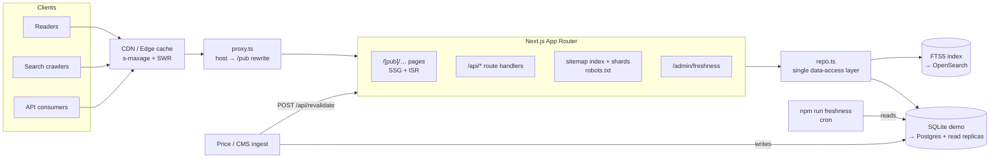

# Entity News Platform (demo)

A small, production-minded demo of a **multi-brand, entity-based business news platform** built with Next.js (App Router), TypeScript and SQL.

Two fictional publications — **Northwind Markets Review** and **Harbor Business Review** — run on one codebase and share one entity graph of companies, executives, industries and countries. Every company, person and publication here is invented.

> Built as a portfolio piece by a backend engineer (C#/.NET, Go, Node.js, SQL) to show how I think about the problems a news platform at scale actually has: entity modelling, programmatic page generation, technical SEO, caching and data freshness.

## What it demonstrates

| Concern | Where to look | Notes |
|---|---|---|
| **Entity-based publishing** | `src/lib/schema.ts`, `article_entities` | Articles link to companies, executives, industries and countries (primary vs. mentioned). One reverse index serves every "related coverage" query. |
| **Programmatic page generation** | `src/app/[pub]/{company,executive,industry,country}/[slug]` | Each brand × entity gets a hub page via `generateStaticParams` + ISR (`revalidate = 3600`). Articles prebuild only the 40 most recent per brand; the long tail renders on first request and is then cached. |
| **Automatic internal linking** | `src/lib/linker.ts` (+ tests) | The first mention of each tagged entity in an article becomes a link to its hub. Longest-name-first, Unicode-aware word boundaries, case-sensitive, capped links per article, returns React segments (no HTML strings, no XSS). |
| **Entity graph** | `coMentionedCompanies()` in `src/lib/repo.ts` | "Often covered with" ranks companies by how many stories they share — a cheap but useful knowledge-graph signal on top of plain same-industry peers. |
| **Multi-brand on one codebase** | `src/lib/publications.ts`, `src/app/[pub]/layout.tsx`, `src/proxy.ts` | Brand = config (name, theme tokens, nav, editorial focus). Works by path prefix (`/northwind/...`) or by host (`northwind.localhost:3000`, or a real domain) via the Next 16 proxy rewrite. |
| **Canonical URLs & syndication** | `src/lib/urls.ts` | All URLs come from one module. ~15% of articles are syndicated to the sister brand; the copy renders under both brands but its canonical points to the origin publication, and only the origin appears in the sitemap. `URL_MODE=host` switches canonicals to per-brand domains. |
| **Structured data** | `src/lib/jsonld.ts` | `NewsArticle` (with `about` vs `mentions`), `Corporation` (ticker, employees), `Person` (`worksFor`), `BreadcrumbList`, `NewsMediaOrganization`. Entities share `@id`s so the graph connects across pages. Output is `<`-escaped. |
| **Sitemaps & crawl budget** | `src/app/sitemap.xml`, `src/app/sitemaps/[file]`, `src/lib/sitemap.ts`, `src/app/robots.ts` | Sitemap index → shards per brand and content type (articles are paginated; shard size is deliberately tiny in the demo so sharding is visible), plus a Google News sitemap (last 48h). `lastmod` for entity hubs = latest related article. Search, API and admin are disallowed/noindexed. |
| **REST API** | `src/app/api/*` | `/api/companies`, `/api/companies/[slug]`, `/api/articles?entity=type:slug&pub=…`, with validated pagination (max page size), 400s for malformed filters, and CDN cache headers (`s-maxage` + `stale-while-revalidate`). |
| **Data freshness** | `src/lib/freshness.ts`, `/admin/freshness`, `npm run freshness` | The seed simulates a broken price feed for a few tickers. Staleness is measured in **business days** (no false alarms every Monday). The CLI exits non-zero so it can back a cron alert. Company pages label delayed prices instead of silently showing old numbers. |
| **On-demand revalidation** | `src/app/api/revalidate` | Secret-protected (`REVALIDATE_SECRET`, constant-time compare). Invalidates an entity or article across **all** brands, so ISR windows can stay long. |
| **Search** | `src/app/[pub]/search`, `src/lib/search.ts` | SQLite FTS5 with BM25 weighting (title > dek > body) and server-side snippets. User input is sanitised into quoted prefix terms so FTS syntax can't break or abuse the query. |
| **Performance** | everywhere | No client components at all — the only JavaScript shipped is Next's router runtime. Price charts are inline SVG computed on the server (no chart library). No CSS framework; one small stylesheet with brand tokens as CSS variables. |

## Architecture



**Data model:** `companies`, `executives`, `industries`, `countries`, `articles`, `article_entities` (the many-to-many core, indexed both ways), `article_syndications`, `prices` (clustered `(company_id, date)`), and an external-content FTS5 table. The SQL is kept portable to PostgreSQL except for FTS5.

## Running it

Requires **Node.js 22.13+** (uses the built-in `node:sqlite`, so there are no native modules to compile).

```bash
npm install
npm run seed        # generates data/news.db (deterministic; dates anchored to today)
npm run dev         # http://localhost:3000
```

```bash
npm test            # vitest unit tests
npm run typecheck   # tsc --noEmit (strict, noUncheckedIndexedAccess)
npm run build       # seeds if missing, then prerenders ~340 pages
npm start
npm run freshness   # CLI staleness report; exit code 1 when stale data exists
```

Things to try:

- `/` → platform index; `/northwind` and `/harbor` → same data, different brands
- `/northwind/company/aldervane-capital` → entity hub with price chart, leadership, co-coverage, peers
- any article → entity links in the body, "In this story", JSON-LD in the page source
- `/northwind/search?q=semiconductor`
- `/sitemap.xml`, `/sitemaps/northwind-articles-1.xml`, `/robots.txt`
- `/api/companies?page=2&pageSize=10`, `/api/companies/aldervane-capital`, `/api/articles?entity=industry:fintech&pub=harbor`
- `/admin/freshness`
- host mode locally: `http://harbor.localhost:3000/company/aldervane-capital`

Environment variables (all optional): `SITE_URL` (canonical origin, default `http://localhost:3000`), `URL_MODE=host` (per-brand domain canonicals), `REVALIDATE_SECRET`, `DATABASE_PATH`, `SEED_TODAY=YYYY-MM-DD`.

## Scaling to ~10M monthly visitors

10M visits/month is roughly 4 req/s on average but news traffic is spiky (a market-moving story can do 50–100× baseline for an hour), and crawlers are a large share of requests. The design goal is: **the origin should almost never be on the hot path.**

1. **CDN first.** Article and entity pages are static/ISR, so the CDN serves them; `stale-while-revalidate` means a traffic spike produces one background regeneration, not thousands of DB queries. API responses carry `s-maxage` too. Target >95% edge hit ratio and monitor it.
2. **ISR + on-demand revalidation.** Keep time-based windows long (hours for entity hubs, a day for articles) and push changes via the revalidate hook from the CMS and price ingest. At millions of entity pages, prebuild only the hot set (most-viewed / recently updated) and let the long tail render on first request — build time stays flat as the catalogue grows. Use tag-based invalidation (an entity tag on every page that renders it) instead of path lists once pages depend on many entities.
3. **Database.** Move to PostgreSQL: a primary for ingest/CMS writes and **read replicas** for rendering and the API (`repo.ts` is the only place that changes). Add connection pooling (PgBouncer / a serverless driver), materialised views or denormalised counters for "most covered" and co-mention graphs, and partition `prices` by time. Prices and "latest" lists can sit in Redis with short TTLs.
4. **Search.** FTS5 is fine for a demo; move to OpenSearch/Elasticsearch (or Postgres `tsvector` at moderate scale) fed by a change stream, with entity facets.
5. **Sitemaps & crawl budget.** Shard by brand and content type (as here) with ~10–45k URLs per file, generated from a precomputed table rather than live queries; keep accurate `lastmod` so crawlers re-fetch only what changed; a news sitemap for the last 48h; noindex/disallow faceted, search and thin pages; consolidate duplicates with canonicals (syndication, tracking params). Watch Search Console indexing per sitemap shard to spot thin entity pages, and only generate hubs for entities above a minimum-coverage threshold.
6. **Multi-brand.** Host-based routing on one deployment; per-brand robots and sitemap index when each brand has its own domain; brand config in a database/CMS rather than code once the number of brands grows.
7. **Data freshness as an SLO.** Run the freshness check on a schedule, alert on breach, and surface "delayed" states in the UI (already done) — trust matters more than a clean-looking chart.
8. **Observability.** Track cache hit ratio, ISR regeneration errors, p95 TTFB at origin, DB replica lag, and Core Web Vitals per template (article / company / index).

## Deliberately out of scope

Authentication for `/admin` (would sit behind SSO or basic auth in the proxy), a CMS/editor UI, pagination UI on entity hubs (the API paginates), images, per-domain sitemap indexes in host mode, and i18n/hreflang.

## Project layout

```
scripts/seed.ts            deterministic fictional data generator
scripts/freshness.ts       staleness CLI
src/proxy.ts               host → publication rewrite (Next 16 "proxy", formerly middleware)
src/lib/                   publications, urls, linker, repo (SQL), jsonld, sitemap, freshness, search, http
src/app/[pub]/             branded pages: home, news, company, executive, industry, country, search
src/app/api/               REST endpoints + revalidate hook
src/app/sitemap.xml, sitemaps/[file], robots.ts
tests/                     vitest unit tests
```

---

## 繁體中文簡介

這是一個以「實體」為核心的多品牌商業新聞平台示範專案：同一份 Next.js 程式碼服務兩個虛構刊物，文章與公司、高管、產業、國家建立關聯，並自動產生實體頁、內部連結、canonical、JSON-LD、分片 sitemap、具快取標頭的 REST API、FTS5 全文搜尋，以及股價資料新鮮度監控。所有公司、人物與刊物名稱皆為虛構。

快速開始：`npm install && npm run seed && npm run dev`，測試：`npm test`，建置：`npm run build`。程式碼註解以繁體中文撰寫，說明每個設計決策的原因。
